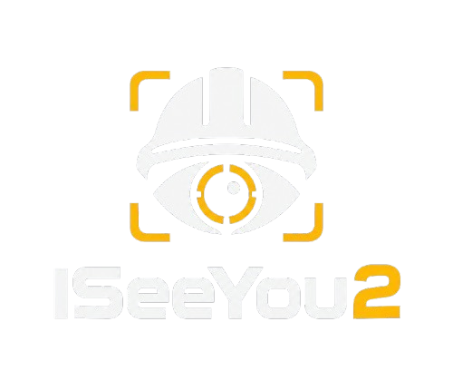
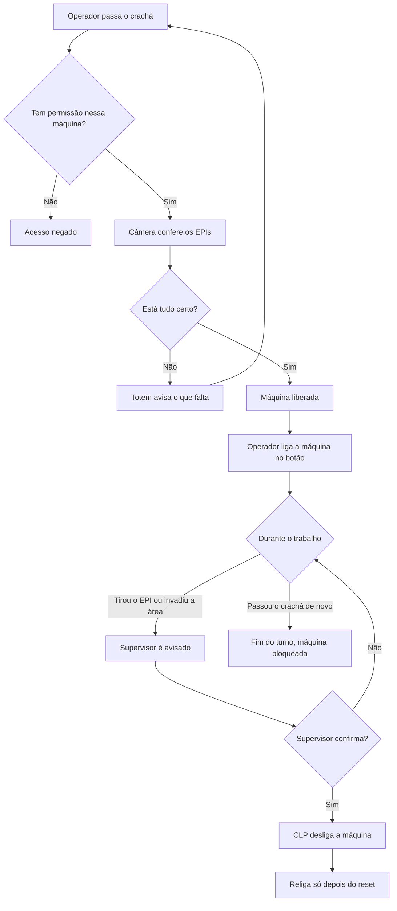

<p align="center">
  
</p>

# 🛡️ ISeeYou2 — Totem de Segurança Industrial com Visão Computacional

Última atualização: 08/11/2026

> Um totem que fica ao lado da máquina e só libera o uso quando o operador passa o crachá, tem permissão e está usando os EPIs (capacete, óculos e luva). Quem confere os EPIs é uma câmera com inteligência artificial. Durante o trabalho, a câmera continua de olho e uma cortina de laser protege a área da máquina. Se alguém tira o EPI ou invade a área, o supervisor é avisado e, se ele confirmar, a máquina para.
>
> É uma camada a mais de segurança: não substitui as proteções da máquina nem os procedimentos, e não é um equipamento de segurança certificado.

**Status:** 🚧 Em desenvolvimento. A IA já detecta os EPIs e o protótipo de bancada (crachá + CLP) já funciona, testado num CLP FX1N. A central, a tela do totem e o painel do supervisor ainda estão sendo construídos.

Projeto Integrador do curso Técnico em Eletromecânica (SENAI), feito para o desafio **Inova SENAI** a partir de uma demanda da empresa **Inear**.

---

## 📌 O problema

A empresa é obrigada a exigir que o funcionário use o EPI (NR-6), mas não tem como ficar de olho em todas as máquinas o tempo todo. O ISeeYou2 faz essa conferência automaticamente e guarda o histórico.

## 🏗️ Como o sistema é montado

```
Crachá + Câmera com IA + Cortina de laser
                 │
                 ▼
   Totem (ESP32) ──► CLP ──► Contator ──► Máquina
       │   ▲          ▲
       │   │          └── Botão de emergência
       │   └── Arduino Nano (cortina de laser)
       ▼
 Central (PC: regras, IA, banco de dados)
       │
  ┌────┴─────────────┐
Tela do totem    Painel do supervisor
```

- **ESP32:** o "cérebro" do totem. Lê o crachá, acende os LEDs, toca os avisos e manda os sinais pro CLP.
- **Arduino Nano:** cuida só da cortina de laser e avisa o ESP32 quando algum feixe é cortado. Na bancada, um Nano faz o papel do totem inteiro enquanto o ESP32 não chega.
- **Central:** um PC que decide quem pode usar a máquina, roda a IA e guarda o histórico.

Tudo funciona na rede local, sem depender de internet.

## 📡 Como as partes conversam

| De → Para | Como |
|---|---|
| Totem ↔ Central | Cabo USB (serial), com mensagens curtas em texto (JSON) |
| Arduino Nano → ESP32 | Serial, avisando quais feixes da cortina estão livres ou cortados |
| Totem → CLP | Sinais de liga/desliga isolados por optoacoplador: "pode liberar" e "pare a máquina" |
| CLP → Totem | Sinais de volta: "máquina ligada" e "bypass ativo" |
| Central → Telas | Rede local (cabo ou Wi-Fi), pelo navegador |
| Câmera → Central | Rede local (câmera IP) ou USB (webcam) |

## 🔁 Como funciona



**Regras que não mudam:**
- Se algo falhar, a máquina não é liberada.
- A máquina nunca liga sozinha: quem dá a partida é sempre o operador, no botão.
- Quem decide parar é uma pessoa, não a IA.
- O botão de emergência funciona direto, sem depender do sistema.

## 🧩 Equipamentos e componentes

**Totem**

| Componente | Função |
|---|---|
| ESP32-S3 | Controla o totem e conversa com a central e com o CLP |
| Leitor RFID + crachás | Identifica o operador |
| Câmera | Captura a imagem pra IA conferir os EPIs |
| Tela | Mostra o nome do operador e o que está faltando |
| Fita de LED colorida | Mostra o resultado de longe (verde liberado, vermelho bloqueado) |
| Luz de LED branca | Ilumina o operador na hora da verificação |
| Módulo de áudio + alto-falante | Avisos de voz ("Coloque a luva") |
| Optoacopladores | Isolam o totem dos 24 V do CLP |
| Fonte e conversores de tensão | Alimentam tudo |

**Cortina de laser**

| Componente | Função |
|---|---|
| Arduino Nano | Lê os sensores da cortina |
| Módulos laser | Formam os feixes em volta da máquina |
| Sensores de luz | Percebem quando um feixe é cortado |
| Postes | Seguram os lasers e sensores nas laterais e na frente |

**Quadro elétrico**

| Componente | Função |
|---|---|
| CLP FX1N | Lógica de segurança: liberação, partida, parada, reset e bypass |
| Contator | Liga e desliga a força da máquina |
| Botões liga, desliga e reset | Comando da máquina |
| Botão de emergência | Para a máquina na hora, direto pelo circuito |
| Chave de bypass | Libera a máquina sem o totem, pra manutenção |
| Sinaleiros e buzzer | Mostram se a máquina está ligada, parada ou em bypass |
| Disjuntor e fonte 24 V | Proteção e alimentação do comando |

## 💻 Linguagens e ferramentas

| Parte | Linguagem / ferramenta |
|---|---|
| IA e central | Python (com a biblioteca YOLO para a detecção) |
| ESP32 e Arduino Nano | C++ (Arduino IDE) |
| CLP | Ladder |
| Tela do totem e painel (em construção) | HTML, CSS e JavaScript |
| Banco de dados | SQLite |
| Placa de circuito | KiCad |
| Estrutura do totem | Fusion 360 |

## 👁️ A inteligência artificial

- Detecta capacete, óculos, luvas e colete com o YOLO11, treinado no dataset SH17.
- Só considera uma falta se ela aparece na maior parte dos últimos quadros, pra não disparar por um movimento rápido.
- Mostra um esqueleto colorido no operador (verde ok, amarelo conferindo, vermelho falta), só como visualização.
- Dá pra usar o celular como câmera.

## 📊 Resultados até agora

| Item | Valor |
|---|---|
| Dataset | SH17: 8.099 imagens |
| Modelo | YOLO11s, 30 épocas |
| Acerto geral (mAP50) | 0,604 |
| Acerto por EPI (mAP50) | capacete 0,694 · óculos 0,629 · luvas 0,571 · colete 0,485 |
| Bancada | Crachá → liberação no CLP funcionando, testado num FX1N |

## 🔒 Privacidade

- O sistema confere a segurança na máquina, não vigia pessoas: não mede produtividade e não grava o tempo todo.
- Sem reconhecimento facial: quem identifica é o crachá.
- O histórico serve pra orientar e treinar, não pra punir.

## 🗺️ Roadmap

- [x] Arquitetura do sistema
- [x] IA treinada para EPI e testada em campo
- [x] Celular como câmera e acesso remoto
- [x] Protótipo de bancada com crachá, tela LCD, cortina e CLP
- [ ] Central (em construção)
- [ ] Tela do totem e painel do supervisor (em construção)
- [ ] Ligar a IA na central
- [ ] Treinar a IA com fotos do ambiente real
- [ ] Cortina de laser completa
- [ ] Totem definitivo com ESP32
- [ ] Quadro elétrico definitivo
- [ ] Teste completo do sistema

## 📅 Log de desenvolvimento

| Data | Atualização |
|---|---|
| _(01/09/2026)_ | Criação do repositório e definição da arquitetura |
| _(17/09/2026)_ | IA treinada e celular funcionando como câmera |
| _(21/09/2026)_ | Esqueleto na tela e interface para celular |
| _(03/11/2026)_ | Nova arquitetura com totem e central. Protótipo da bancada conversando com o CLP FX1N |
| _(07/11/2026)_ | Simulação 3D do sistema e planejamento das próximas fases |

---

**Dataset:** [SH17](https://github.com/ahmadmughees/SH17dataset), licença CC BY-NC-SA 4.0 (uso não comercial).

> Projeto autoral em desenvolvimento, documentado publicamente para aprendizado e portfólio.
