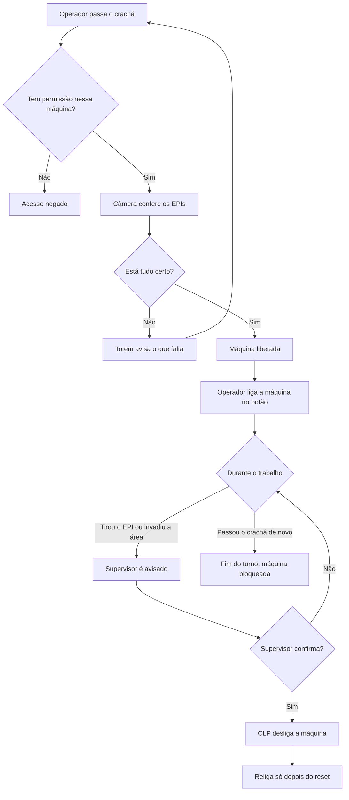

<p align="center">
  
</p>

# 🛡️ ISeeYou2 — Totem de Segurança Industrial com Visão Computacional

Última atualização: 08/11/2026

> Um totem que fica ao lado da máquina e só libera o uso quando o operador passa o crachá, tem permissão e está usando os EPIs (capacete, óculos e luva). Quem confere os EPIs é uma câmera com inteligência artificial. Durante o trabalho, a câmera continua de olho e uma cortina de laser protege a área da máquina. Se alguém tira o EPI ou invade a área, o supervisor é avisado e, se ele confirmar, a máquina para.
>
> É uma camada a mais de segurança: não substitui as proteções da máquina nem os procedimentos, e não é um equipamento de segurança certificado.

**Status:** 🚧 Em desenvolvimento. A IA, a central e o protótipo de bancada (crachá + CLP) já funcionam. Agora é juntar a IA com a central e montar o totem definitivo.

Projeto Integrador do curso Técnico em Eletromecânica (SENAI), feito para o desafio **Inova SENAI** a partir de uma demanda da empresa **Inear**.

---

## 📌 O problema

A empresa é obrigada a exigir que o funcionário use o EPI (NR-6), mas não tem como ficar de olho em todas as máquinas o tempo todo. O ISeeYou2 faz essa conferência automaticamente e guarda o histórico.

## 🏗️ Como o sistema é montado

```
Crachá + Câmera com IA + Cortina de laser
                 │
                 ▼
     Totem (microcontrolador) ──► CLP ──► Contator ──► Máquina
                 │                 ▲
                 ▼                 └── Botão de emergência
       Central (PC: regras, IA, banco de dados)
                 │
        ┌────────┴────────┐
  Tela do totem     Painel do supervisor
```

Tudo funciona na rede local, sem depender de internet. O acesso remoto é só para visualizar e demonstrar.

## 🔁 Como funciona



**Regras que não mudam:**
- Se algo falhar, a máquina não é liberada.
- A máquina nunca liga sozinha: quem dá a partida é sempre o operador, no botão.
- Quem decide parar é uma pessoa, não a IA.
- O botão de emergência funciona direto, sem depender do sistema.

## 🧩 O que tem no projeto

| Parte | O que faz |
|---|---|
| Crachá RFID | Identifica o operador |
| Câmera + IA (YOLO11) | Confere capacete, óculos e luva |
| Cortina de laser | Avisa se alguém entra na área da máquina pela frente ou pelos lados |
| Totem | Junta crachá, cortina e sinais do CLP, e mostra o resultado na tela, nos LEDs e no som |
| Central | Decide quem pode usar a máquina, roda a IA e guarda o histórico |
| Painel do supervisor | Mostra tudo ao vivo e é onde o supervisor confirma as paradas |
| CLP + quadro elétrico | Liga e desliga a máquina com segurança (liga, desliga, reset, emergência e bypass) |

## 👁️ A inteligência artificial

- Detecta capacete, óculos, luvas e colete com o YOLO11, treinado no dataset SH17.
- Só considera uma falta se ela aparece na maior parte dos últimos quadros, pra não disparar por um movimento rápido.
- Mostra um esqueleto colorido no operador (verde ok, amarelo conferindo, vermelho falta), só como visualização.
- Dá pra usar o celular como câmera.

## 📊 Resultados até agora

| Item | Valor |
|---|---|
| Dataset | SH17: 8.099 imagens |
| Modelo | YOLO11s, 30 épocas |
| Acerto geral (mAP50) | 0,604 |
| Acerto por EPI (mAP50) | capacete 0,694 · óculos 0,629 · luvas 0,571 · colete 0,485 |
| Bancada | Crachá → central → liberação no CLP funcionando |

## 🔒 Privacidade

- O sistema confere a segurança na máquina, não vigia pessoas: não mede produtividade e não grava o tempo todo.
- Sem reconhecimento facial: quem identifica é o crachá.
- O histórico serve pra orientar e treinar, não pra punir.

## 🗺️ Roadmap

- [x] Arquitetura do sistema
- [x] IA treinada para EPI e testada em campo
- [x] Celular como câmera e acesso remoto
- [x] Central, tela do totem e painel do supervisor
- [x] Protótipo de bancada com crachá, tela, cortina e CLP
- [ ] Ligar a IA na central
- [ ] Treinar a IA com fotos do ambiente real
- [ ] Cortina de laser completa
- [ ] Totem definitivo
- [ ] Quadro elétrico definitivo
- [ ] Teste completo do sistema

## 📅 Log de desenvolvimento

| Data | Atualização |
|---|---|
| _(01/09/2026)_ | Criação do repositório e definição da arquitetura |
| _(17/09/2026)_ | IA treinada e celular funcionando como câmera |
| _(21/09/2026)_ | Esqueleto na tela e interface para celular |
| _(03/11/2026)_ | Nova arquitetura com totem e central: painel do supervisor, tela do totem e protótipo da bancada integrado ao CLP |
| _(07/11/2026)_ | Simulação 3D do sistema e planejamento das próximas fases |

---

**Dataset:** [SH17](https://github.com/ahmadmughees/SH17dataset).

> Projeto autoral em desenvolvimento, documentado publicamente para aprendizado e portfólio.
